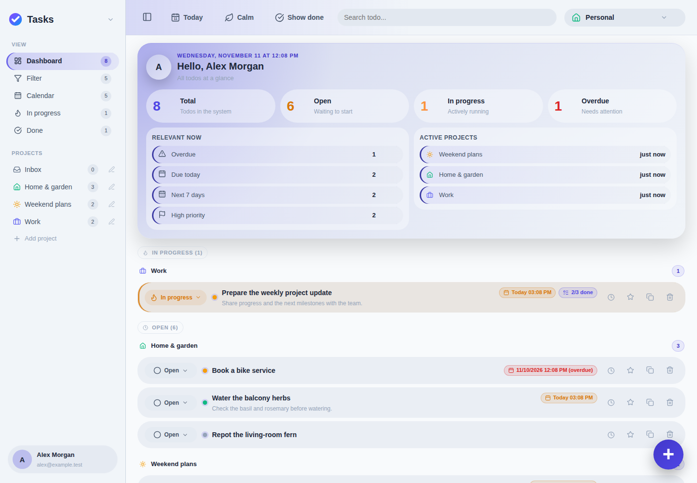
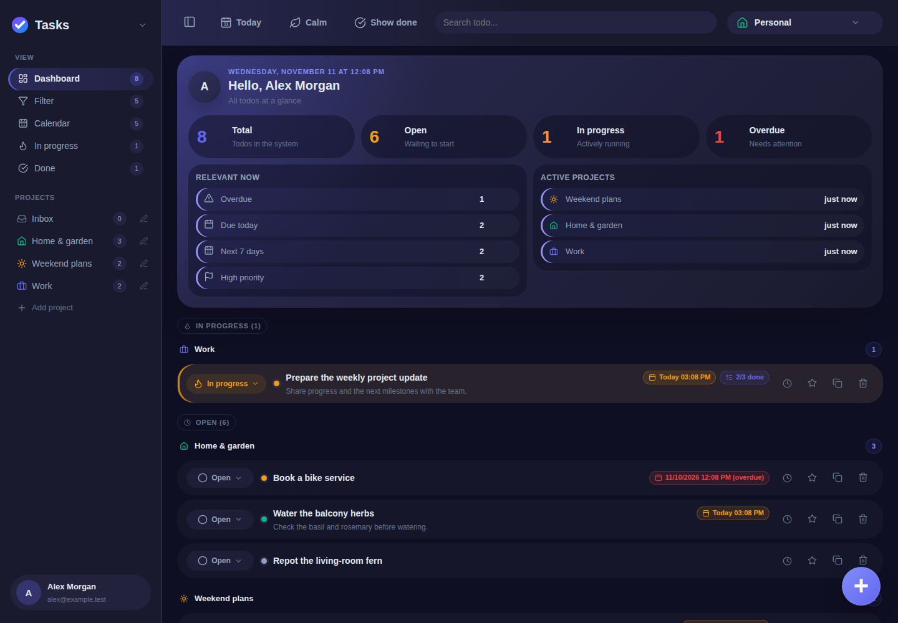
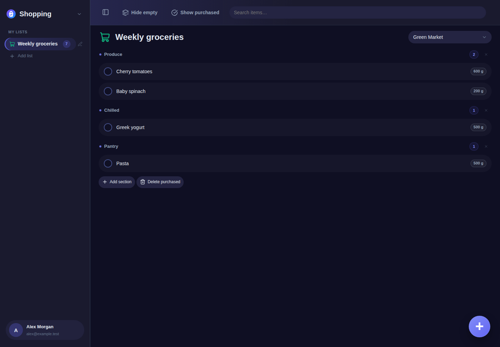
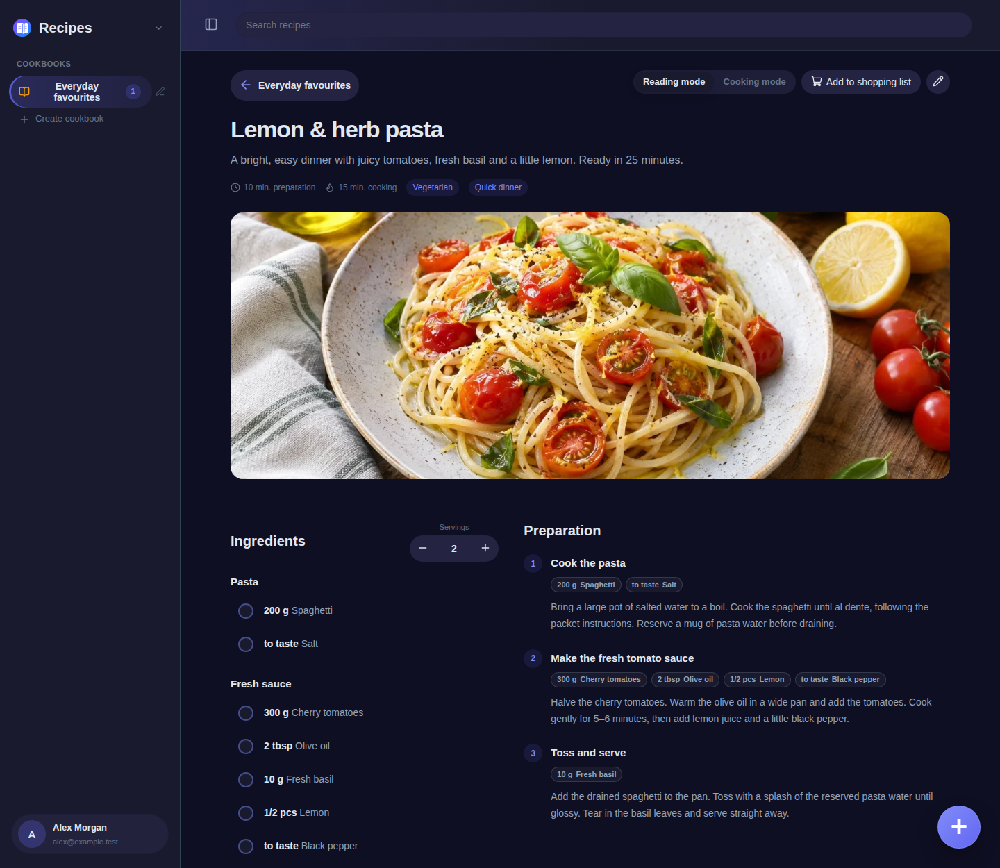
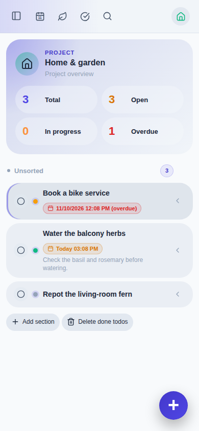
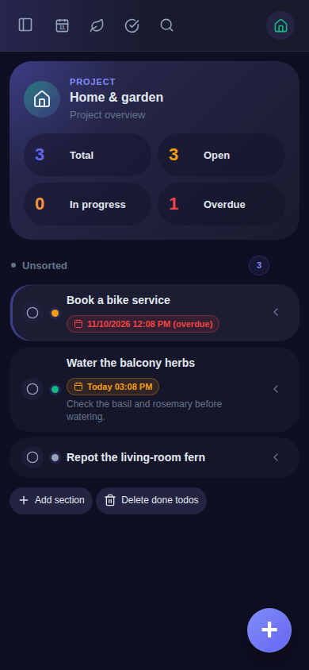
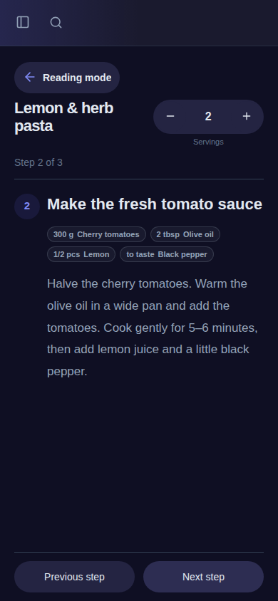

<div align="center">


# Nia

**Everyday life. Simply organized.**

A modern, self-hosted app for organizing everyday life, with offline support, collaboration, native clients, and no external service dependency.

[](LICENSE)
[](https://github.com/weedpump/nia-todo/releases/latest)
[](https://github.com/weedpump/nia-todo/actions/workflows/tests.yml)
[](https://hub.docker.com/r/weedpump/nia-todo)


**[Website](https://nia.homelabdiary.dev) · [Documentation](https://nia.homelabdiary.dev/docs) · [Install](https://nia.homelabdiary.dev/docs/get-started) · [Releases](https://github.com/weedpump/nia-todo/releases/latest)**

</div>

---

> **V4 development:** This README describes the work on the `v4` branch. V4 has not been released yet; the release links and `latest` Docker image currently provide the published 3.x line.

Nia keeps personal and shared everyday organization in one place while leaving you in control of the infrastructure. The FastAPI server stores its data in SQLite and serves the responsive web app, offline-capable PWA, and downloads for the bundled native clients from your own instance.

## A quick look

<p align="center">
  
  
</p>

## Three modules, one app

| Module | What you can organize |
| --- | --- |
| **Tasks** | Todos in projects, subprojects, sections, and personal workspaces, with priorities, deadlines, reminders, recurring schedules, subtasks, comments, and attachments. |
| **Shopping** | Shared shopping lists with sections, quantities, units, and stores. Add several items at once, mark purchases, and keep your list available offline. |
| **Recipes** | Cookbooks with recipe cards, tags, images, structured ingredients, and preparation steps. Adjust portions, use the cooking view, and transfer selected ingredients to a shopping list with compatible quantities combined. |

Choose which modules to show in your account settings. This choice follows your account across devices; it does not delete your data.

<p align="center">
  
  
</p>

<details>
<summary>Mobile Tasks and cooking views</summary>

<p align="center">
  
  
  
</p>

</details>

## Highlights

- **Keep working offline.** The installable PWA caches the app shell and queues changes locally until the server is available again.
- **Share selectively.** Keep projects, shopping lists, and cookbooks personal, share them with individual users, or transfer them to your household. Households share content; workspaces remain personal organizational views.
- **Remember everyday choices.** Personal routing memory fills remembered projects or lists, sections, and stores as editable badges. Choices from manual entry, BrainDump, and recipe ingredient transfers contribute to the same memory, which you can correct or reset.
- **Cook with the quantities at hand.** Assign ingredients and partial quantities to individual steps, scale portions, and follow the cooking view without repeatedly scrolling back to the ingredient list.
- **Import recipes for review.** Import a supported recipe link into an editable draft, optionally including its image. With BrainDump access, also import free text or refine a draft, including ingredient assignments to steps.
- **Use the app everywhere.** Run Nia in the browser or through the native Windows, Android, and Debian clients, with platform-aware notifications and reminders.
- **Sign in securely.** Built-in authentication supports TOTP, passkeys, recovery codes, trusted devices, email verification, and optional OIDC/SSO.
- **Capture mixed thoughts.** BrainDump turns spoken notes into Tasks and Shopping suggestions in one review, with editable destinations before saving.
- **Make it yours.** Choose a light or dark theme and use the interface in any of 12 supported languages.

The core app and personal routing memory do not require an AI service. An administrator must enable BrainDump for your account, and an LLM provider must be configured; voice capture also needs a speech-to-text provider. Providers can run locally or remotely. Recipe link imports need an online connection but do not require BrainDump; free-text import and AI refinement use the account's BrainDump permission. Review imported and AI-generated drafts before saving.

## Languages

Nia is available in:

🇩🇪 **German** (`de`) · 🇬🇧 **English** (`en`) · 🇨🇿 **Czech** (`cs`) · 🇫🇷 **French** (`fr`) · 🇮🇹 **Italian** (`it`) · 🇳🇱 **Dutch** (`nl`) · 🇵🇱 **Polish** (`pl`) · 🇧🇷 **Brazilian Portuguese** (`pt-BR`) · 🇷🇺 **Russian** (`ru`) · 🇸🇪 **Swedish** (`sv`) · 🇪🇸 **Spanish** (`es`) · 🇨🇳 **Simplified Chinese** (`zh-CN`)

## Install

The recommended way to run Nia is with **Docker**:

```bash
docker run -d \
  --name nia-todo \
  --restart unless-stopped \
  -p 8753:8753 \
  -e NIA_TODO_HOST=auto \
  -e NIA_TODO_PORT=8753 \
  --read-only \
  --tmpfs /tmp \
  --cap-drop ALL \
  --security-opt no-new-privileges:true \
  -v nia-todo-data:/data \
  docker.io/weedpump/nia-todo:latest
```

Read the one-time setup token from `docker logs nia-todo` (or `journalctl -u nia-todo` for the Debian package), then open `http://YOUR-SERVER:8753/setup`. The token is required only for first-run setup and is deleted after the first user is created. For production, place the app behind HTTPS and set its public base URL in the admin panel.

A full **Debian/Ubuntu package** with systemd integration and built-in updates is available from [Releases](https://github.com/weedpump/nia-todo/releases/latest). Detailed guides cover both installation methods:

**[Docker guide](https://nia.homelabdiary.dev/docs/install/docker) · [Debian/Ubuntu guide](https://nia.homelabdiary.dev/docs/install/debian)**

The product name is **Nia**. Existing repository, image, package, service, and database names such as `nia-todo`, and configuration variables beginning with `NIA_TODO_`, remain unchanged for compatibility.

## Documentation

Installation, configuration, native apps, backups, updates, security, and troubleshooting are covered in the documentation:

**[nia.homelabdiary.dev/docs](https://nia.homelabdiary.dev/docs)**

- [API documentation](https://nia.homelabdiary.dev/docs/api/)

Developer references stay with the source:

- [Architecture](docs/architecture.md)
- [Testing](docs/testing.md)
- [Release workflow](docs/workflow.md)
- [Changelog](CHANGELOG.md)

## Contributing

Bug reports, feature ideas, translations, and pull requests are welcome. See [CONTRIBUTING.md](CONTRIBUTING.md) for the development setup, source builds, coding conventions, and contribution workflow.

## License

Nia is free software licensed under the [GNU Affero General Public License v3.0 or later](LICENSE). See [NOTICE](NOTICE) for additional attribution and legal notices.

Copyright (C) 2026 Tobias Kneidl
